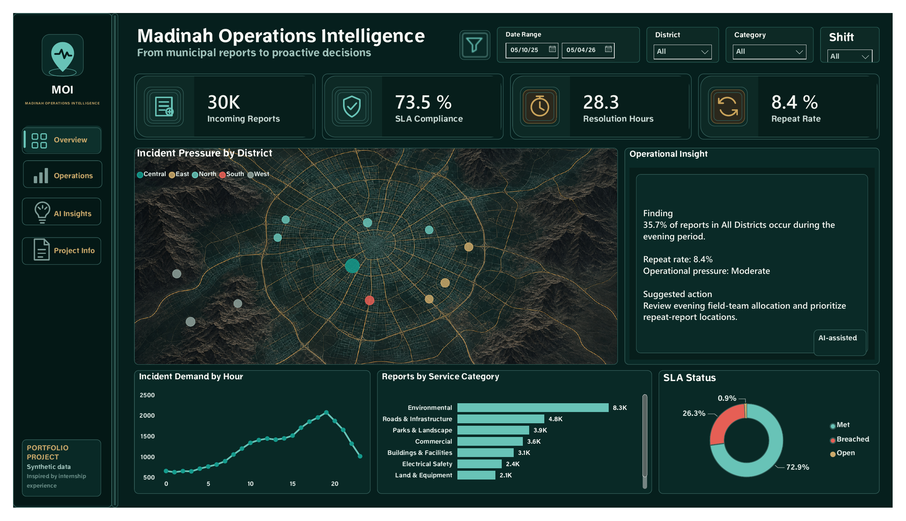
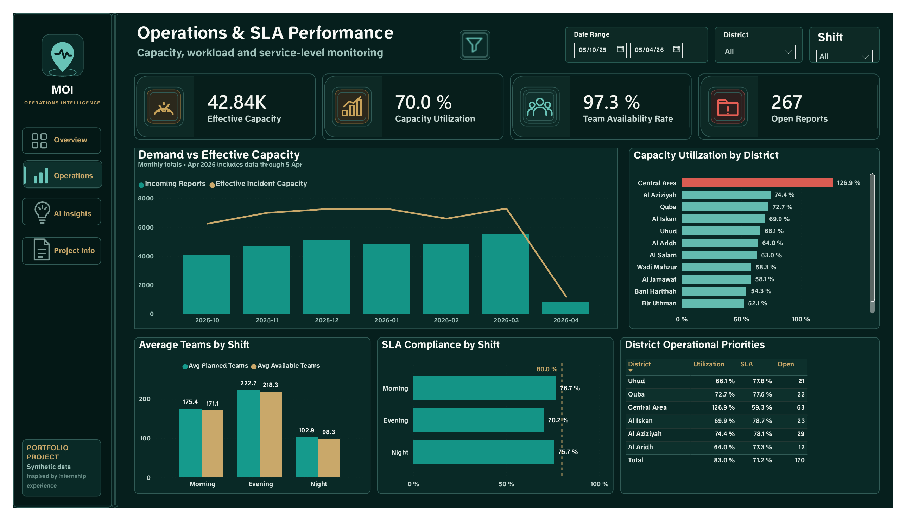
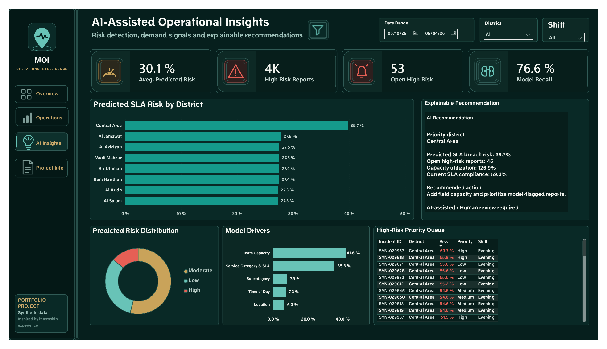
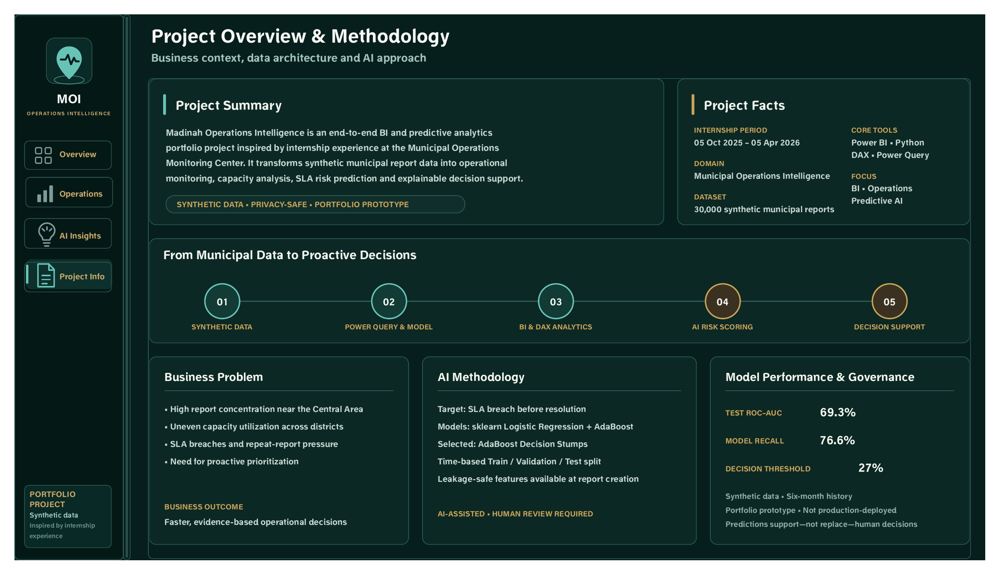

# Madinah Operations Intelligence

**Business Intelligence · Operations Analytics · Responsible Predictive Analytics**

An end-to-end portfolio case study inspired by my internship experience at the Municipal Operations Monitoring Center in Madinah. The solution transforms **30,000 privacy-safe synthetic reports** into operational monitoring, capacity analysis, SLA-risk prioritization, and explainable decision support.

> **Project scope:** Independent portfolio prototype using synthetic data. It is not an official Municipality product and has not been production-deployed.

> **Technical remediation:** The Python model, CSV exports, documented DAX and
> portable Power Query templates have been corrected. The existing PBIX,
> screenshots and PDFs remain unchanged historical exports and still contain
> older labels/metrics. Power BI Desktop refresh and verification remain pending;
> follow the [Desktop handoff](documentation/POWER-BI-DESKTOP.md). The original map,
> mountains, background image, colors and page composition are preserved.



## Recruiter snapshot

- **Business need:** Give operations teams a clear view of demand, field capacity, SLA performance, and priority reports.
- **My contribution:** Data preparation, dimensional modeling, DAX measures, dashboard design, predictive modeling, validation, documentation, and responsible-use controls.
- **Tools:** Power BI, Power Query, DAX, Python, pandas, NumPy, and scikit-learn.
- **Deliverables:** Four-page dashboard, documented measures, model-training code, model metrics, feature importance, model card, and synthetic fact/dimension tables.

## Business questions

The project explores:

- Where are incoming reports concentrated?
- Does operational capacity match demand across districts and shifts?
- Which service-level risks require attention?
- Which open reports should be reviewed first?
- How can predictive insight support—not replace—operational judgment?

## Solution

The Power BI report contains four connected pages:

1. **Overview** — Executive KPIs, district pressure, hourly demand, service categories, SLA status, and an operational finding.
2. **Operations** — Demand versus effective capacity, utilization, team availability, shift-level SLA performance, and operational priorities.
3. **AI Insights** — Predicted SLA-breach risk, risk distribution, model drivers, recommendation logic, and a high-risk review queue.
4. **Project Info** — Business context, architecture, methodology, model performance, limitations, and governance.

## Predictive methodology

- **Target:** SLA breach before report resolution.
- **Models evaluated:** scikit-learn Logistic Regression and AdaBoost decision stumps.
- **Preprocessing:** A fitted `ColumnTransformer` performs numeric imputation and scaling plus categorical imputation and one-hot encoding.
- **Model packaging:** Each classifier is evaluated inside a reproducible scikit-learn `Pipeline`; the selected fitted pipeline is exported with `joblib`.
- **Selected model:** AdaBoost decision stumps, chosen by validation ROC-AUC.
- **Validation design:** Creation-time cohorts with labels required to be resolved before each decision cutoff; 645 late-available labels are excluded from their original cohorts.
- **Feature availability:** Outcome fields are excluded. Daily staffing totals are also excluded because their availability at incident creation is unverified. Remaining synthetic feature and censoring assumptions are disclosed in the model card.
- **Corrected test ROC-AUC:** 68.7% (historical 69.3%).
- **Recall:** 85.3% (historical 76.6%).
- **Precision:** 33.6% (historical 36.6%); higher recall produces more false alerts.
- **Review threshold:** 24% (historical 27%), selected on validation only.

The predictions are designed to support prioritization and require human review.
The same 6,057 resolved test rows support the before/after comparison; test
results have already been inspected and are a retrospective evaluation, not a
new untouched holdout. See the [model card](ai-model/AI-MODEL-CARD.md) and
[controlled comparison](documentation/validation-comparison.json).

## Metric definitions

- **AssignmentDelayHours** comes from AssignedAt minus CreatedAt, without
  modifying historical records. The source ResponseHours field has unknown
  semantics and is retained but excluded from assignment/response KPIs.
- **Open = 2; In Progress = 265; Active = 267.** Corrected Active High Risk is
  **39**, all In Progress; Open High Risk is **0**. High risk means probability
  >= 0.40 and differs from the binary review threshold of 0.24.
- **Nominal incident capacity = 356,984** at date/district/shift grain. The old
  42,838.08 effective-capacity figure uses an unsupported 0.12 factor and is
  preserved only as an explicitly unvalidated historical scenario. The primary
  source demand/nominal-capacity ratio is 8.4037%, not a real productivity claim.
- Prediction probabilities retain binary64 precision. Round percentages for
  display only; 77 legacy classifications became inconsistent when four-decimal
  exported scores were re-thresholded.

Full definitions and independently computed KPIs are in the
[remediation report](documentation/REMEDIATION.md) and
[KPI reconciliation](documentation/dashboard-kpi-reconciliation.json).

## Technology

- Power BI Desktop
- Power Query
- DAX
- Python
- pandas, NumPy, scikit-learn, and joblib
- Synthetic source data (original generator not included)
- Data-quality validation

## Repository structure

```text
dashboard/       Power BI report
screenshots/     Exported dashboard pages
data/            Synthetic fact and dimension tables
ai-model/        Training code, metrics, feature importance, and model card
dax/             Corrected measure and calculated-column definitions
power-query/     Portable source templates; apply and verify in Desktop
tests/           Source, model, export and dashboard regression checks
documentation/   Historical PDFs, evidence, corrections and Desktop handoff
```

## Run the model

From the repository root:

The tested runtime is Python 3.12.14 with the exact versions in requirements.txt.

```bash
python -m pip install -r requirements.txt
python -m unittest discover -s tests -v
python ai-model/train_sla_risk_model.py
python ai-model/verify_exports.py
python ai-model/audit_dashboard.py
```

The script validates the synthetic fact and dimension tables and exports the
fitted pipeline, metrics, feature importance, district summaries and incident
scores. Model selection and threshold tuning use the validation cohort only;
test labels do not select the model or threshold. The pickle is a generated,
ignored local artifact and must be regenerated before `verify_exports.py`.
The committed CSV/JSON outputs can be tested without a pickle. For Python CSV
consumers, use `pd.read_csv(..., float_precision="round_trip")` for scores.

To independently reproduce the historical implementation from real Git history,
the cutoff-only diagnostic and the corrected default in isolated directories:

```bash
python ai-model/reproduce_remediation.py --output-dir /tmp/moi-reproduction
```

Choose a different writable scratch path on Windows. This requires the baseline
commit in local Git history and the pinned dependencies. It does not rewrite
source records. Original data-generation reproducibility is unavailable: only
the metadata seed and supplied tables survive; see [provenance](data/PROVENANCE.md).

## Dashboard previews

These are preserved historical previews. Their older model/capacity/status
labels are audited in the remediation report; they have not been re-exported.

### Operations and SLA performance



### AI-assisted operational insights



### Methodology and governance



## Responsible use

- All records are synthetic and privacy-safe.
- The model is a portfolio prototype, not a production service.
- Recommendations require human review.
- Performance and limitations are disclosed in the model card.
- Predictive outputs should not be used as the sole basis for operational decisions.

## Author

**Yomna Alhejaili**  
Junior Data & Business Intelligence Analyst  
Power BI · SQL · Python · Reporting · Performance · Operations Analytics

- [LinkedIn](https://www.linkedin.com/in/yomna-alhejaili-0b3991216)
- [GitHub](https://github.com/youmnaeidh)
